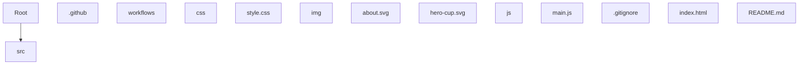

# 🚀 warkop-mondai

**[EN]** warkop-mondai project

**[ID]** warkop-mondai project

---

[]()
[]()
[]()
[]()


---

## ✨ Features / Fitur

> **[EN]** Key features of this project.

> **[ID]** Fitur utama dari project ini.

<!-- Add your features here: -->
- Feature 1
- Feature 2

---

## 🏗️ Architecture / Arsitektur

**[EN]** Project structure overview.

**[ID]** Ikhtisar struktur project.

``
.github/
  workflows/
css/
  style.css
img/
  about.svg
  hero-cup.svg
js/
  main.js
.gitignore
index.html
README.md
``



---

## 🛠️ Tech Stack


---

## 🚀 Quick Start

### Prerequisites

* [](https://git-scm.com/)


### Installation / Instalasi

```bash
# Clone
git clone https://github.com/GrayZeus20/Warkop-Mondai.git
cd warkop-mondai

# Install dependencies / Install dependensi
# No dependencies to install
```

### Development / Pengembangan

```bash
# Start dev server / Jalankan server development
# See scripts in package.json or composer.json
```

### Build

```bash
# No build step
```

### Testing / Pengujian

```bash
# Add test script
```

---

## ⚙️ Configuration / Konfigurasi

**[EN]**


**[ID]**


```bash


```

---

## 📜 Available Commands / Perintah Tersedia


---

## 📚 Documentation / Dokumentasi

<!-- Add documentation links here -->

---

## 🕒 Recent Changes / Perubahan Terbaru

* Add smooth scrolling and animations to homepage and menu sections
* Update portfolio styles and content
* Initial commit - Warkop Mondai website

---

## 🛡️ Security / Keamanan

**[EN]**
* API keys and secrets are never committed to Git.
* All .env files are git-ignored.
* Only .env.example with placeholder values is tracked.

**[ID]**
* API key dan rahasia tidak pernah di-commit ke Git.
* Semua file .env di-gitignore.
* Hanya .env.example dengan nilai placeholder yang di-track.

---

## 🤝 Contributing / Kontribusi

1. Fork this repository
2. Create a feature branch (git checkout -b feature/amazing-feature)
3. Commit your changes (git commit -m 'Add amazing feature')
4. Push to the branch (git push origin feature/amazing-feature)
5. Open a Pull Request

---

## 👤 Author / Pengembang

Dandi January

---

## 📄 License / Lisensi

MIT © 2026
